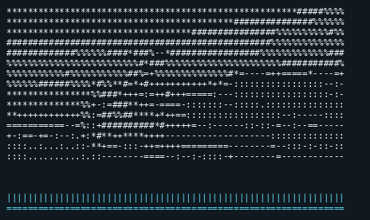

# moqy

`moqy` is a Linux terminal client that subscribes to MoQT media using draft 22.
It decodes video with FFmpeg and displays it as grayscale ASCII. Audio plays
through SDL's default output device. If no device opens, a five-line waveform
appears below the video. `--waveform` selects the waveform instead of speaker
playback.

## Preview



Captured from a short section of [Big Buck Bunny](https://download.blender.org/peach/bigbuckbunny_movies/BigBuckBunny_320x180.mp4.zip)
published through `moqxr` and `moqt://moq-relay.red5.net:4433`, with
`--waveform` enabled. (c) copyright 2008, Blender Foundation /
www.bigbuckbunny.org. [Creative Commons Attribution 3.0](https://peach.blender.org/about/).

## Quick start

Build from this checkout with a draft-22-capable `moq5` source tree and its
picoquic/picotls dependencies:

```sh
cmake -S . -B build \
  -DMOQ5_SOURCE_DIR="$PWD/../moq5" \
  -DMOQ_PICOQUIC_SOURCE_DIR="$PWD/../picoquic" \
  -DMOQ_PICOTLS_PREFIX="$PWD/../picotls/build"
cmake --build build --target moqy -j
./build/moqy --help
```

Then, from an interactive terminal, subscribe to the exact namespace your
publisher uses:

```sh
./build/moqy moqt://moq-relay.red5.net:4433 demo/bbb
```

Press Ctrl-C to quit. The relay address is a tested example; `demo/bbb` only
produces media while a compatible publisher is publishing that namespace.
See the [CLI guide](docs/cli-guide.md) for dependency setup, a complete
publisher example, WebTransport, audio options, and troubleshooting.

## Build requirements

Requires CMake 3.20+, a moq5 checkout with draft-22 service support,
picoquic and picotls for moq5, FFmpeg development libraries (`libavcodec`,
`libavutil`, `libswscale`, `libswresample`), SDL2 development files, and
pkg-config. A compatible moq5 checkout is expected at `../moq5` by default.
The picoquic managed transports require a picoquic source tree. Run
`ctest --test-dir build --output-on-failure` to check the local decode and
render tests after building.

The moq5 source must define `MOQ_VERSION_DRAFT_22`. Both managed transports
used by this build require the picoquic source tree.

## CLI

```text
./build/moqy <moqt://host:port|https://host:port/path> <namespace> \
  [--waveform] [--insecure-skip-verify]
```

`moqt://` selects native QUIC; `https://` selects WebTransport and needs the
relay's WebTransport path. Namespace components are separated by `/` and must
match the publisher exactly. Certificate verification is enabled by default.
Use `--insecure-skip-verify` only for a local relay with a self-signed
certificate. Standard output must be an interactive terminal.

The current client subscribes to one namespace and uses its media catalog to
discover tracks. Supported clear codecs are H.264, HEVC, AV1, AAC, and Opus
when the local FFmpeg build supplies their decoders. It accepts raw/LOC
packets and single-`mdat` CMAF objects. Encrypted tracks and unsupported
codecs are skipped; multi-chunk CMAF objects may fail to decode. The publisher
must support draft 22 and provide a compatible catalog. The tested publisher
example uses `moqxr`.
